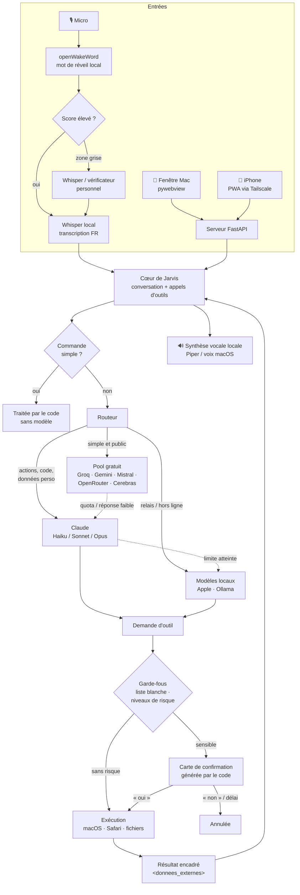

# Jarvis — assistant vocal personnel pour macOS

> **Code source complet privé, démonstration possible sur demande.**
> Ce dépôt est une vitrine : présentation, architecture et quelques extraits de code représentatifs.

Jarvis est un assistant IA vocal qui tourne sur mon Mac (et sur iPhone, via une web-app). On l'appelle
par la voix (« Hey Jarvis »), il comprend le français, répond à voix haute et agit sur l'ordinateur :
ouvrir des applications, piloter Safari, gérer des fichiers, créer des rappels, rédiger un CV ou une
lettre en PDF, lancer des tâches de code… le tout avec des **garde-fous imposés par le code**, pas par le
modèle d'IA.

Je le développe seul, en binôme avec **[Claude Code](https://claude.com/claude-code)** : je définis
les besoins, l'architecture et les règles de sécurité, je relis et teste chaque changement dans
l'application installée ; Claude Code m'aide à écrire le code et les tests.

---

## Démo

<!-- Remplacer par la vidéo ou le GIF de démonstration, par exemple :

ou un lien vers une vidéo : [▶ Voir la démo (2 min)](https://…)
-->

*Vidéo de démonstration à venir.*

---

## Fonctionnalités

### 🎙️ Réveil vocal
- Détection locale du mot de réveil « Hey Jarvis » avec **openWakeWord** (~100 ms, sans réseau).
- Réveil en deux temps : score élevé → réveil direct ; zone grise → confirmation par Whisper avec une
  correspondance phonétique tolérante (« Travis », « Jervis »…).
- Vérificateur personnel entraînable en local sur la voix de l'utilisateur, et option « n'écouter que ma
  voix » (empreinte vocale WeSpeaker en ONNX, calculée et stockée en local).
- Mode conversation : après une réponse, Jarvis réécoute quelques secondes sans mot de réveil, et ignore
  les phrases qui ne lui sont pas adressées ainsi que l'écho de sa propre voix.

### 📝 Transcription 100 % locale
- **Whisper** sur l'appareil (mlx-whisper sur le GPU Apple, repli sur faster-whisper) : l'audio ne quitte
  jamais le Mac.
- Transcriptions peu fiables filtrées (probabilité d'absence de parole, log-probabilité moyenne).
- Chaîne audio travaillée : chien de garde qui relance le flux en moins de 500 ms quand des écouteurs
  Bluetooth se connectent, rééchantillonnage 48 → 16 kHz avec un filtre de 255 coefficients.

### 🔀 Routage entre plusieurs modèles d'IA, avec solutions de repli
- **Claude** (via l'abonnement, Haiku / Sonnet / Opus selon la difficulté) pour les actions, le code, le
  raisonnement et tout ce qui touche aux données personnelles.
- **Pool gratuit** (Groq, Gemini, Mistral, OpenRouter, Cerebras) pour les demandes simples et publiques :
  il ne reçoit que la question du moment, sans mémoire ni historique.
- **Modèles locaux** : modèle d'Apple (service Swift) et Ollama (`qwen3:1.7b`, choisi pour tenir dans
  8 Go de RAM).
- Commandes simples (heure, volume, ouvrir une app) traitées directement par le code, sans modèle.
- Replis automatiques : quota atteint ou erreur → fournisseur suivant ; HTTP 429 → pause jusqu'à la
  réinitialisation ; réponse gratuite insuffisante → relance avec Claude ; limite Claude atteinte →
  « mode relais » (actions mises en attente, données personnelles traitées en local).
- Cache local de 24 h pour les questions générales et tableau de bord des quotas.

### 🔒 Sécurité par conception
- **Liste blanche shell** : seules des commandes en lecture seule s'exécutent directement. Suppressions,
  redirections, substitutions, fichiers sensibles (`.ssh`, `.env`…) ou programmes inconnus → mis en attente.
- **Niveaux de risque** : ce qui est réversible s'exécute tout de suite ; ce qui est irréversible ou
  sensible (envoyer un message ou un e-mail, supprimer, capturer l'écran, lancer Claude Code) attend un
  « oui » explicite. La carte de confirmation est **générée par le code** et montre exactement ce qui
  sera exécuté ; sans réponse dans le délai, l'action est annulée, jamais exécutée.
- **Le modèle ne peut pas se confirmer lui-même** : les arguments réservés au programme sont filtrés.
- **Anti-injection de prompt** : tout contenu externe (page web, fichier, presse-papiers, résultat
  d'outil) est encadré comme des données et ne peut pas fermer cet encadrement. Une action demandée par
  le contenu d'un fichier ou d'une page est bloquée : seules les paroles de l'utilisateur comptent.
- **Données personnelles** jamais envoyées aux API gratuites ; captures d'écran floutées en aperçu et
  effacées après 24 h.

### Et aussi
Pilotage de Safari et des applications, documents (CV, lettres, rapports PDF), suivi de candidatures,
tâches de code déléguées à Claude Code sur une branche Git dédiée, web-app iPhone (PWA via Tailscale),
mascotte animée « Arc » qui reflète l'état de l'assistant.

---

## Architecture



---

## Stack technique

| Domaine | Technologies |
|---|---|
| Langage principal | Python 3 (≈ 60 modules) ; Swift (service du modèle local d'Apple) ; JavaScript, HTML, CSS (interfaces) |
| Voix | openWakeWord, mlx-whisper / faster-whisper, WeSpeaker (ONNX), Piper TTS, AVFoundation |
| IA | Claude (via Claude Code, `claude -p` en flux), Groq, Gemini, Mistral, OpenRouter, Cerebras, Ollama, modèle d'Apple |
| Application | FastAPI + Uvicorn, pywebview, rumps (barre de menus), py2app (`Jarvis.app` signée localement) |
| macOS | AppleScript, PyObjC (Accessibilité, AVFoundation) |
| Mobile | PWA (service worker, manifest) servie via Tailscale |
| Documents | WeasyPrint, PyMuPDF, python-docx |
| Tests | unittest, mocks des modèles et du micro, sondes JS dans un vrai Chrome sans interface |

---

## Quelques chiffres

| | |
|---|---|
| **Tests automatisés** | **921 tests** répartis dans 54 fichiers, exécutés hors ligne (modèles, micro et Mac simulés : aucun test n'agit sur le vrai Mac) |
| **Réveil vocal** | **9/12 (75 %) mesuré sur 12 enregistrements réels** de « Hey Jarvis » (contre 0/12 avant la refonte du réveil en deux temps) |
| **Latence (oral)** | fin de la phrase → début de la voix : **3,53 s → 1,70 s** (médianes mesurées dans l'application installée) |
| **Latence (écrit)** | premier mot : **1,94 s → 0,93 s** |
| **CPU au repos** | **~40 % → ~5 %** du CPU (traitement vocal d'Apple seulement en conversation, animations en pause hors de vue) |
| **Modèle local** | 12/12 appels d'outils justes sur le banc d'essai, avec un modèle de 1,7 Go adapté à un Mac de 8 Go |

---

## Extraits de code

Le dossier [`excerpts/`](excerpts/) contient des extraits simplifiés, autonomes et testables :

| Fichier | Contenu |
|---|---|
| [`securite.py`](excerpts/securite.py) | Liste blanche shell, niveaux de risque et confirmations, encadrement anti-injection, exécution des outils |
| [`routeur_extrait.py`](excerpts/routeur_extrait.py) | Classification des demandes : quel modèle répond, données personnelles protégées, détection des réponses insuffisantes |
| [`test_securite.py`](excerpts/test_securite.py) | Tests représentatifs (adaptés de la suite complète) |

```bash
cd excerpts
python3 -m unittest -v test_securite.py
```

---

## Méthode de travail

- Développement itératif avec **Claude Code** : chaque fonctionnalité part d'un besoin réel, est
  accompagnée de tests, puis vérifiée dans l'application installée.
- Les bugs rencontrés en usage réel (journaux de réveil, scénarios de conversation) deviennent des tests
  de non-régression.
- Contraintes assumées : pas d'API payante utilisée automatiquement, Mac de 8 Go de RAM, audio et
  données personnelles traités en local autant que possible.

---

**Code source complet privé, démonstration possible sur demande.**

---

**Jean Bonheur Brillant NGUEMA** — élève-ingénieur ISEP  
[LinkedIn](https://www.linkedin.com/in/jean-bonheur-nguema-097044346)
